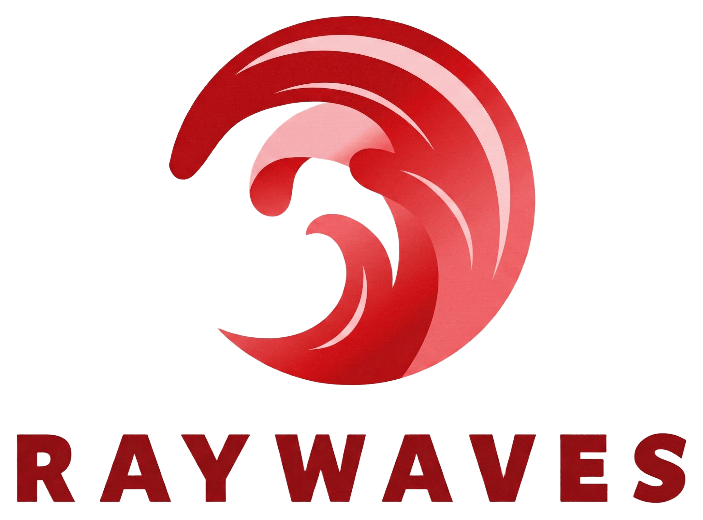
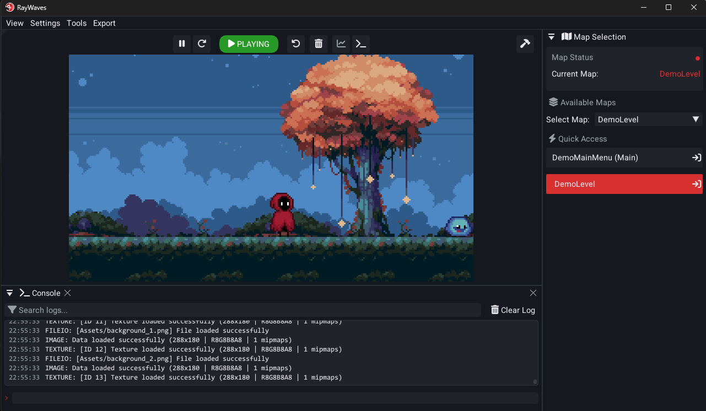
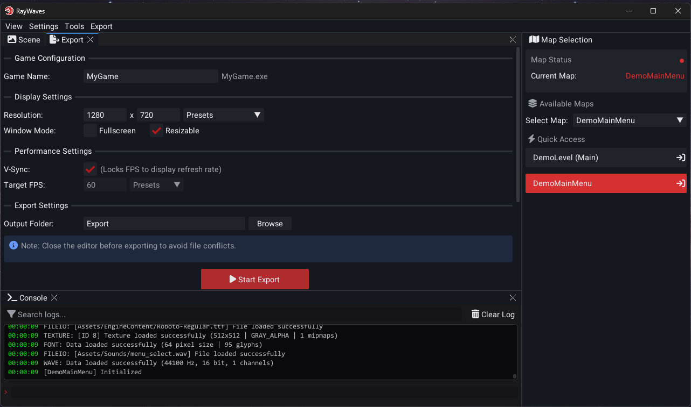

<div align="center">
  
  <h1>RayWaves Game Engine</h1>
  <p><b>A lightweight, code-first game engine built on Raylib with hot-reloading.</b></p>
</div>

RayWaves is a C++23 game engine for developers who want to edit gameplay code
and see the result without restarting the game. Gameplay is compiled into a
GameLogic module (`GameLogic.dll` on Windows, `GameLogic.so` on Linux) that the
editor and runtime reload through a shadow copy, so game state survives code
changes via opt-in `SaveState` / `LoadState`.

## Features

- Hot-reloading gameplay module, typically well under a second.
- Windows zero-install toolchain: Zig, Ninja, and CMake are fetched on demand
  (plus rcedit for icon embedding). Linux uses system GCC/G++ and can fetch
  CMake/Ninja.
- ImGui editor with scene view, file browser, inspector, export panel, and profiler overlay.
- Edit live gameplay entity positions from the editor with one registration line per entity.
- Viewport navigation while stopped: middle-mouse pan, wheel zoom at cursor, `F` frame.
- Sprite prop layer authored in the editor and saved per map in `Assets/<MapId>.scene`.
- Simple map system built on `GameMap` and `MapManager`.
- One-command project templates and distribution packaging.
- `rwcli` builds, validates, screenshots, and inspects existing projects for agents.

## Screenshots


*Scene editing, asset browser, and live reload in the editor.*


*Export settings for a standalone build.*

## Quick start

Requirements: Windows or Linux, plus CMake. Windows fetches Zig, Ninja, and
CMake into `Tools/` automatically. Linux uses the system GCC/G++ and fetches
CMake/Ninja when needed.

Windows:

```powershell
cmake --preset zig-release
cmake --build build/zig-release
build/zig-release/RayWaves.exe
```

Linux:

```sh
cmake --preset zig-release
cmake --build build/zig-release
./build/zig-release/RayWaves
```

Linux build dependencies (Debian/Ubuntu):

```sh
sudo apt install build-essential cmake ninja-build \
  libx11-dev libxrandr-dev libxinerama-dev libxcursor-dev libxi-dev \
  libgl1-mesa-dev libasound2-dev
```

Run the test suites:

```powershell
scripts/test.ps1
```

```sh
./scripts/test.sh
```

Run benchmarks:

```powershell
scripts/bench.ps1
```

```sh
./scripts/bench.sh
```

Package a distribution:

```powershell
scripts/package.ps1 -IncludeCompiler -Zip
```

```sh
./scripts/package.sh --archive
```

## Repository map

| Path | Purpose |
|---|---|
| `Engine/` | Core engine static library |
| `Editor/` | ImGui editor (`RayWaves.exe` / `RayWaves`) |
| `Runtime/` | Editor/runtime entry points and module loading |
| `tests/` | Unit, integration, and smoke suites |
| `benchmarks/` | Standalone performance harness |
| `templates/` | Starter projects (Simple2D, Platformer2D, ThirdPerson3D, SlimeQuest) |
| `.github/workflows/` | Windows + Linux CI and packaging |
| `packaging/` | Distribution scripts and the shared project CMake template |
| `scripts/` | Day-to-day developer commands |
| `cmake/` | Build modules |
| `docs/` | Guides and reference |

## Commands

| Task | Windows | Linux |
|---|---|---|
| Configure release | `cmake --preset zig-release` | `cmake --preset zig-release` |
| Build editor | `cmake --build build/zig-release --target main` | same |
| Build runtime | `cmake --build build/zig-release --target game` | same |
| Build agent CLI | `cmake --build build/zig-release --target rwcli` | same |
| Run a project headless | `build/zig-release/rwcli.exe run <project> --frames 60 --screenshot shot.png --json` | `./build/zig-release/rwcli run ...` |
| Configure editor/LSP | `build/zig-release/rwcli.exe lsp <project> --check --json` | `./build/zig-release/rwcli lsp ...` |
| Unit tests | `scripts/test.ps1 -Suite unit` | `./scripts/test.sh --suite unit` |
| All tests | `scripts/test.ps1` | `./scripts/test.sh` |
| Benchmarks | `scripts/bench.ps1` | `./scripts/bench.sh` |
| Formatting + tests | `scripts/check.ps1` | `./scripts/check.sh` |
| Distribution | `scripts/package.ps1` | `./scripts/package.sh` |

## Documentation

- [Documentation index](docs/README.md)
- [Linux](docs/linux.md)
- [Agent CLI](docs/agent/README.md)
- [Architecture](docs/ARCHITECTURE.md)
- [Developer guide](docs/DEVELOPER_GUIDE.md)
- [Testing](docs/testing.md)
- [Benchmarks](docs/benchmarks.md)
- [Distribution](docs/distribution.md)
- [Game developer guide](docs/GAME_DEVELOPER_GUIDE.md)
- [Troubleshooting](docs/TROUBLESHOOTING.md)

## Adding a map

```cpp
#include "GameMap.h"

class MyLevel : public GameMap
{
public:
    MyLevel() : GameMap("MyLevel") {}

    void Update(float delta_time) override
    {
        if (IsKeyDown(KEY_SPACE)) Jump();
    }

    void Draw() override
    {
        DrawText("Hello World!", 100, 100, 20, WHITE);
    }
};
```

Register it in your project's `RootManager.cpp`:

```cpp
s_GameMapManager->RegisterMap<MyLevel>("Level_1");
```

Gameplay code belongs in your project's `GameLogic/`, never in `Engine/`.

## License

See [LICENSE](LICENSE).
