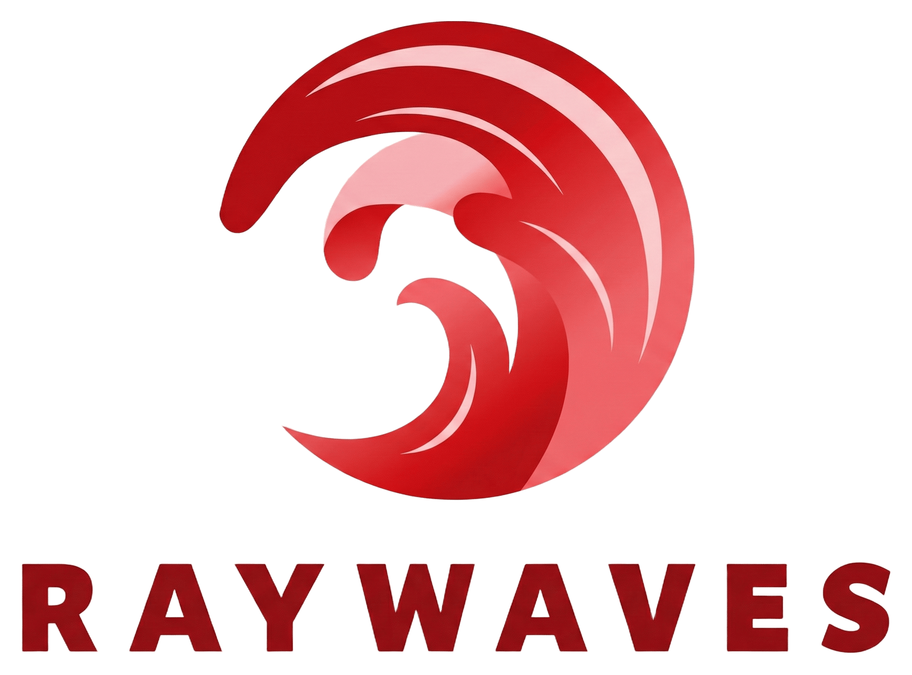
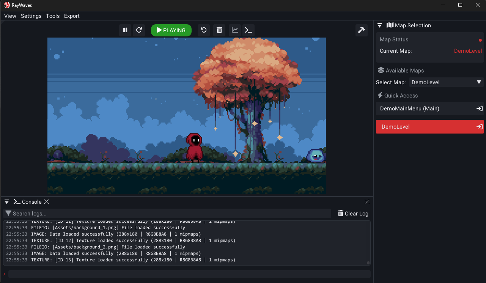
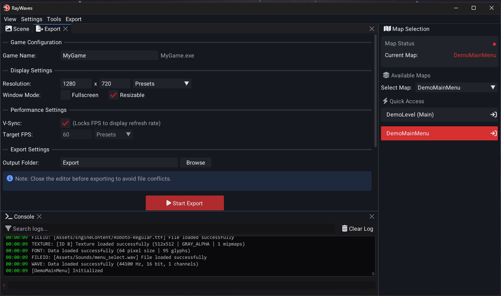

<div align="center">
  
  <h1>RayWaves Game Engine</h1>
  <p><b>A lightweight, code-first 2D engine built on Raylib with hot-reloading.</b></p>
</div>

RayWaves is a C++23 game engine for developers who want to edit gameplay code
and see the result without restarting the game. Gameplay is compiled into a
`GameLogic.dll` that the editor and runtime reload through a shadow copy, so game
state survives code changes via opt-in `SaveState` / `LoadState`.

## Features

- Hot-reloading gameplay DLL, typically well under a second.
- Zero-install toolchain: Zig, Ninja, CMake, and rcedit are fetched on demand.
- ImGui editor with scene view, asset browser, export panel, and profiler overlay.
- Simple map system built on `GameMap` and `MapManager`.
- One-command project templates and distribution packaging.

## Screenshots


*Scene editing, asset browser, and live reload in the editor.*


*Export settings for a standalone build.*

## Quick start

Requirements: Windows and CMake. The rest is downloaded automatically.

```powershell
cmake --preset zig-release
cmake --build build/zig-release
build/zig-release/RayWaves.exe
```

Run the test suites:

```powershell
scripts/test.ps1
```

Run benchmarks:

```powershell
scripts/bench.ps1
```

Package a distribution:

```powershell
scripts/package.ps1 -IncludeCompiler -Zip
```

## Repository map

| Path | Purpose |
|---|---|
| `Engine/` | Core engine static library |
| `Editor/` | ImGui editor (`RayWaves.exe`) |
| `Runtime/` | Editor/runtime entry points and DLL loading |
| `tests/` | Unit, integration, and smoke suites |
| `benchmarks/` | Standalone performance harness |
| `templates/` | Starter projects (Empty, Platformer2D, SlimeQuest) |
| `packaging/` | Distribution scripts and the shared project CMake template |
| `scripts/` | Day-to-day developer commands |
| `cmake/` | Build modules |
| `docs/` | Guides and reference |

## Commands

| Task | Command |
|---|---|
| Configure release | `cmake --preset zig-release` |
| Build editor | `cmake --build build/zig-release --target main` |
| Build runtime | `cmake --build build/zig-release --target game` |
| Unit tests | `scripts/test.ps1 -Suite unit` |
| All tests | `scripts/test.ps1` |
| Benchmarks | `scripts/bench.ps1` |
| Formatting + tests | `scripts/check.ps1` |
| Distribution | `scripts/package.ps1` |

## Documentation

- [Documentation index](docs/README.md)
- [Architecture](docs/ARCHITECTURE.md)
- [Developer guide](docs/DEVELOPER_GUIDE.md)
- [Testing](docs/testing.md)
- [Benchmarks](docs/benchmarks.md)
- [Distribution](docs/distribution.md)
- [Game developer guide](docs/GAME_DEVELOPER_GUIDE.md)
- [Troubleshooting](docs/TROUBLESHOOTING.md)

## Adding a map

```cpp
#include "GameMap.h"

class MyLevel : public GameMap
{
public:
    MyLevel() : GameMap("MyLevel") {}

    void Update(float delta_time) override
    {
        if (IsKeyDown(KEY_SPACE)) Jump();
    }

    void Draw() override
    {
        DrawText("Hello World!", 100, 100, 20, WHITE);
    }
};
```

Register it in your project's `RootManager.cpp`:

```cpp
s_GameMapManager->RegisterMap<MyLevel>("Level_1");
```

Gameplay code belongs in your project's `GameLogic/`, never in `Engine/`.

## License

See [LICENSE](LICENSE).
