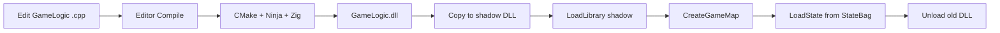
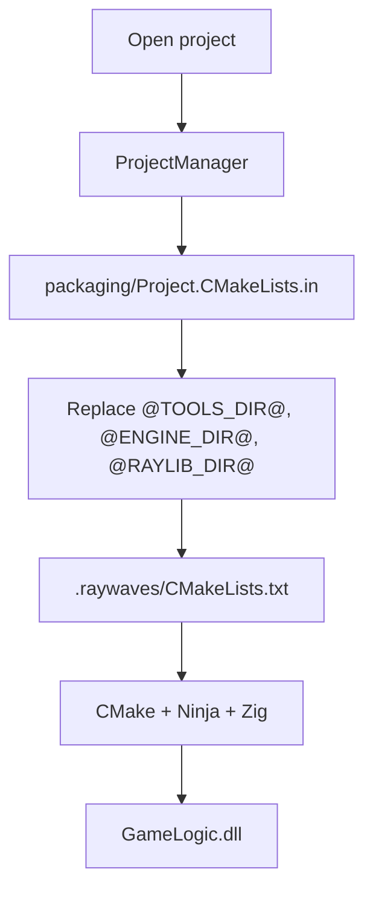

# Engine Documentation

Start here if you are changing the engine, editor, runtime, build, or tests.

## Core reading

- [Architecture](../ARCHITECTURE.md) — repository tree, build modules, project layout.
- [Developer guide](../DEVELOPER_GUIDE.md) — hot-reload internals, profiling, conventions.
- [Testing](../testing.md) — suites, CTest labels, adding tests.
- [Benchmarks](../benchmarks.md) — harness, baseline, regression checks.
- [Distribution](../distribution.md) — package layout and validation.
- [Troubleshooting](../TROUBLESHOOTING.md) — common build/runtime failures.

## Hot-reload flow

## Project CMake generation

## Where to change what

- Core systems: `Engine/` + `cmake/Engine.cmake` + a test.
- Editor UI: a panel under `Editor/Panels/`.
- Host entry points / DLL loading: `Runtime/`.
- Build behavior: `cmake/*.cmake`.
- Test suites: `tests/`.
- Performance cases: `benchmarks/`.
- Packaging: `packaging/` + `scripts/package.ps1`.
